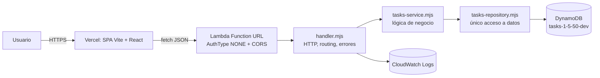

# Arquitectura

## Vista de componentes



## Capas y reglas de dependencia

```
handler ──► service ──► repository ──► DynamoDB
   │            │
   └──► http, validation, config
```

- **handler** (`lambda/src/handler.mjs`): traduce el evento HTTP de la Function URL
  (payload 2.0) a llamadas de servicio; decide status codes y CORS. **No** conoce DynamoDB.
- **service** (`tasks-service.mjs`): reglas de negocio (timestamps, ids, defaults,
  actualización parcial, orden). **No** conoce HTTP ni el SDK de AWS.
- **repository** (`tasks-repository.mjs`): único punto que usa `@aws-sdk/client-dynamodb`.
  Convierte entre el modelo de dominio y el item de DynamoDB.
- **validation** (`validation.mjs`): validación de payloads, independiente de HTTP.
- **http** / **config**: helpers de respuesta y errores, y lectura de variables de entorno.
  CORS se configura en la Function URL (AWS), no en el handler, para evitar cabeceras duplicadas.

Regla: las dependencias solo apuntan hacia dentro (`handler → service → repository`).
El service se testea con un repository en memoria, sin AWS.

## Frontend

```
main.tsx → App.tsx → components/*
                │
                ├── hooks/useTasks.ts  (estado y mutaciones)
                └── services/api.ts    (fetch tipado, ApiError)
```

- `components/` solo presentación; no llaman a `fetch`.
- `useTasks` centraliza carga, errores, avisos y mutaciones.
- `services/api.ts` es el único módulo que conoce `VITE_API_URL` y el contrato HTTP.
- `types.ts` define el modelo compartido (sin `any`).

## Flujo principal

1. `App` monta `useTasks`, que hace `GET /tasks`.
2. El usuario crea/edita/completa/elimina → `useTasks` llama a `tasksApi`.
3. La Lambda valida (`validation`), aplica la regla (`service`) y persiste (`repository`).
4. La respuesta actualiza el estado local; la UI muestra aviso accesible (`aria-live`).

## Infraestructura (Terraform)

| Recurso | Uso |
|---|---|
| `aws_dynamodb_table.tasks` | Persistencia, `PAY_PER_REQUEST`, PK `id` (S) |
| `aws_iam_role` + `aws_iam_role_policy` | Permisos mínimos DynamoDB + logs |
| `aws_cloudwatch_log_group` | Retención de logs (7 días) |
| `aws_lambda_function.api` | Runtime `nodejs20.x`, 256 MB, 10 s |
| `aws_lambda_function_url.api` | Exposición pública `NONE` + CORS |
| `aws_lambda_permission` | Invocación pública de la Function URL |

El artefacto se genera con `archive_file` a partir de `lambda/` (excluye tests) y se versiona
con `source_code_hash`.
